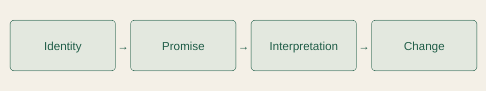

# Making a global graduate programme feel inclusive

CBS group exam project,2025/26. An exploratory academic study, not employment or consultancy for Arla. Findings below describe the group study; individual work is not represented as sole authorship.

**Course:** Organisational Change and Diversity Management

## Question
How could Arla communicate its F15 graduate programme in a way that makes international pathways and belonging more visible?

## Approach
The group compared qualitative interview themes, structured interpretations of employer-branding webpages and public annual reports. Identity construction and change communication connected the evidence to a proposed intervention.

## Findings
The study identified a tension between a strong Nordic, farmer-owned corporate identity and F15’s global positioning. International pathways and inclusion were not always as explicit in the reviewed entry points as the programme promise suggested.

## Proposed next step
An ADKAR-informed change plan would align internal understanding and external messaging, use concrete examples of international pathways and test applicant interpretations. This is a proposal, not a measured recruitment result.

## Limits
A small interview base, interpretive reading and a 2025 website snapshot. No increase in applicant diversity or application conversion was established. No interview transcripts or identifiable quotations are included.
