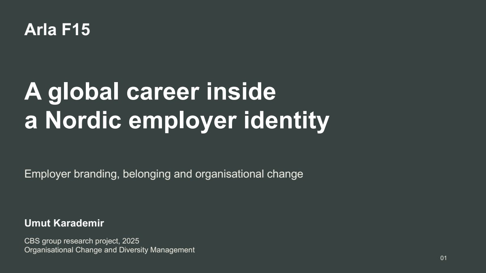
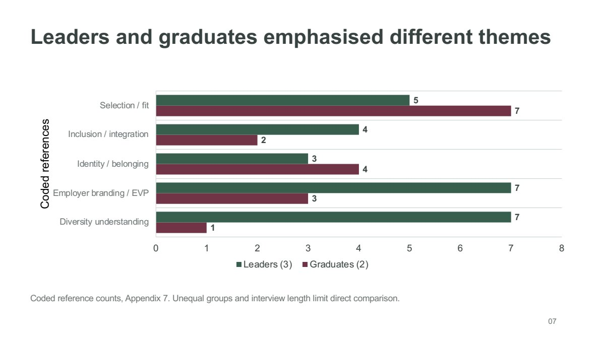

# Arla F15

**Employer branding and inclusion** · Copenhagen Business School

A qualitative study of how corporate identity, global career pathways and everyday belonging shape the employer story. The findings inform a proposed change programme.

[Read the full case](https://umut-karademir-portfolio.snowy-crumb-3052.chatgpt.site/arla.html) · [PDF](../dist/assets/Arla_F15_Case_Study.pdf) · [Editable PowerPoint](../dist/assets/Arla_F15_Case_Study.pptx)

## Inside the presentation

The 14-slide deck compares corporate and F15 communication, explains the five qualitative themes, visualises the coded-reference comparison between leaders and graduates, and develops the proposed 12-month ADKAR intervention.

Group research by Altug Umut Karademir, Anna Gao, Dennis Chen Dai and Emilia Alexandra Prinzler.

