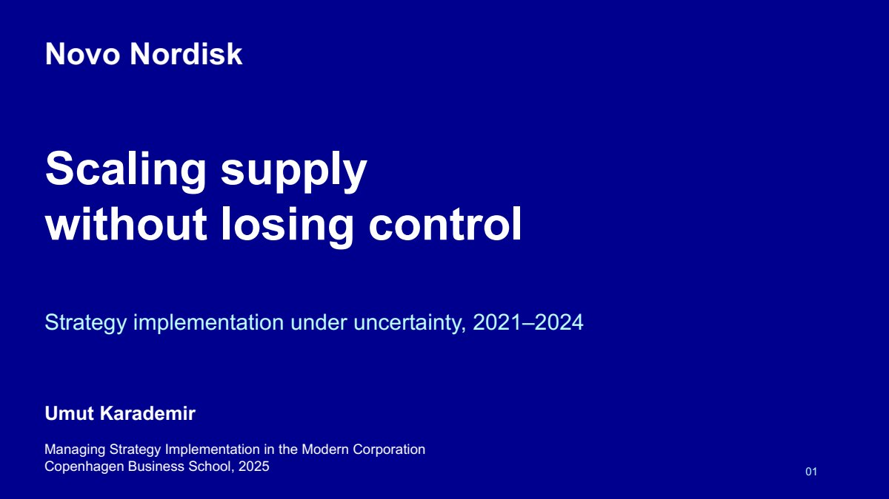
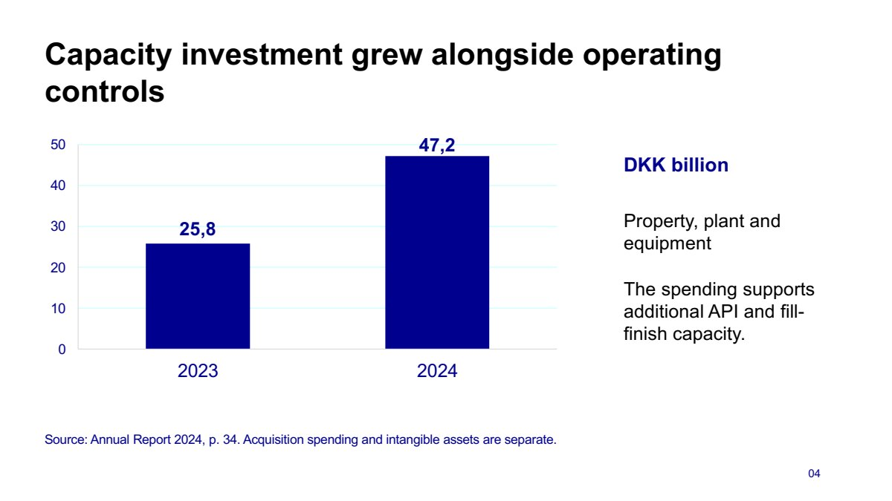

# Novo Nordisk

**Strategy implementation** · Copenhagen Business School

An analysis of how authority, information and operating routines shape expansion under uncertainty. Public evidence informs a practical decision and review framework.

[Read the full case](https://umut-karademir-portfolio.snowy-crumb-3052.chatgpt.site/novo-strategy.html) · [PDF](../dist/assets/Novo_Nordisk_Strategy_Case_Study.pdf) · [Editable PowerPoint](../dist/assets/Novo_Nordisk_Strategy_Case_Study.pptx)

## Inside the presentation

The 16-slide deck examines the 2021–2024 implementation context, compares four theoretical perspectives and develops a proposed trigger table and review cycle. The acquisition timeline and capital expenditure chart are checked against official company publications.

Individual paper by Altug Umut Karademir.

