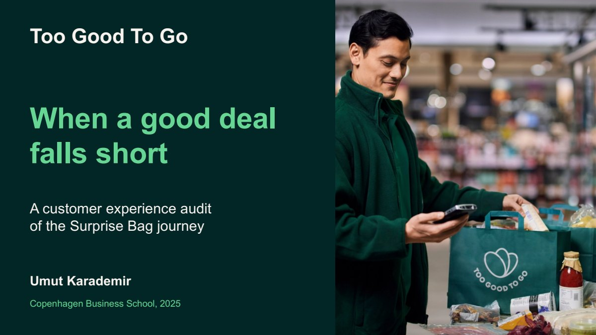
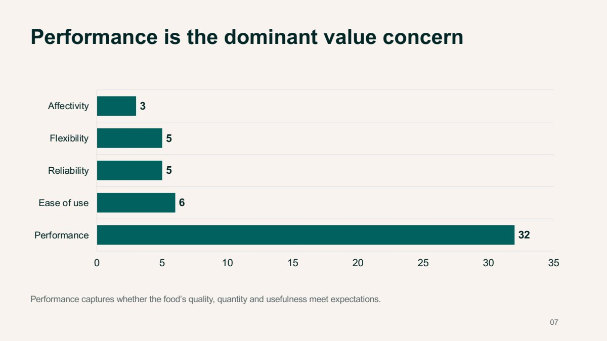

# Too Good To Go

**Customer experience audit** · Copenhagen Business School

Customer reviews reveal where the Surprise Bag experience falls short. Journey mapping and PERFA coding connect the findings to two proposed service concepts.

[Read the full case](https://umut-karademir-portfolio.snowy-crumb-3052.chatgpt.site/too-good-to-go.html) · [PDF](../dist/assets/TGTG_Customer_Experience_Case_Study.pdf) · [Editable PowerPoint](../dist/assets/TGTG_Customer_Experience_Case_Study.pptx)

## Inside the presentation

The 16-slide deck follows the customer journey and the coding of 51 selected reviews. It includes journey-stage counts, PERFA dimensions, their intersection, descriptive severity comparisons, two service proposals and a phased testing plan.

I prepared the paper, analysis and presentation materials for the group submission.

