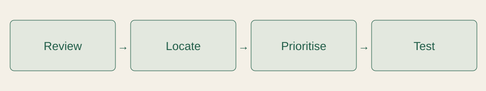

# Where the Surprise Bag experience breaks down

CBS academic group project, Fall 2025. Not commissioned by Too Good To Go. I prepared the paper, analysis and presentation materials; the original submission is group-authored.

**Course:** Customer Experience and Business Model Innovation

## Question
How could a food-sharing platform better connect the value people expect with the experience they receive?

## Approach
The audit combined motivation analysis with manual coding of 51 negative Trustpilot reviews:17 each at one, two and three stars. Each complaint was coded for a dominant journey stage and perceived-value dimension. R supported the analysis, with AI-assisted scripting disclosed in the paper.

## Findings
Post-purchase experiences accounted for 39 of 51 selected complaints. Performance—the practical quality and quantity of the bag—was the dominant value category, appearing in 32 of 51. These patterns point to areas worth investigating, rather than estimating the experience of all customers.

## Proposed next step
The coursework proposed a feedback and resolution assistant and a merchant–customer co-creation hub. A focused next experiment would test a post-purchase resolution flow, checking understanding, resolution success and satisfaction before considering a wider rollout.

## Limits
Self-selected negative reviews and deliberately balanced star categories limit generalisation. No retention or satisfaction improvement was demonstrated. Motivation charts are omitted until sample descriptions are reconciled.
